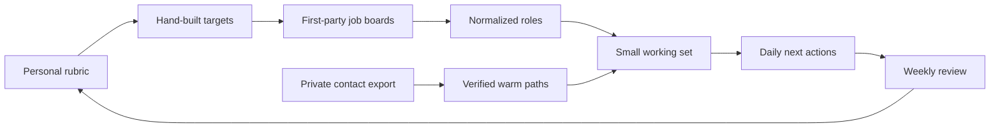

# Build Your Own Compass

Compass is a local-first operating system for a focused job search. It helps you decide which companies deserve attention, find the people who can give you an honest read, track live opportunities, and make the next action obvious.

This repository is a build kit, not a hosted service and not a copy of anyone else's career data. You will use Claude Code to build a version around your own rubric, workflow, and privacy boundaries.

## Start here

1. Read [the build log](docs/build-log.md).
2. Create an empty private data directory outside this repository.
3. Open this repository in Claude Code.
4. Run the prompts in `prompts/` in numerical order.
5. Do not build the dashboard until the Markdown workflow has survived two weekly reviews.

The first useful version is not a polished app. It is a system that can answer five questions without guessing:

1. Which companies am I deliberately targeting, and why?
2. Where do I have a real warm path?
3. Which opportunities are active, and what happens next?
4. Which follow-ups are due or overdue?
5. What changed my mind this week?

## The central design choice

The rubric comes before the software. If you cannot explain what makes a company, role, and working arrangement right for you, automation only helps you process the wrong list faster.

Compass keeps three decisions separate:

- **Eligibility:** hard constraints that can rule something out.
- **Fit:** how well the company or role matches your stated preferences.
- **Priority:** what deserves attention now, based on timing, access, and an actual next action.

Do not collapse these into one magic score. A great company can have no live role. A mediocre fit can still deserve a short conversation. Missing evidence is `unknown`, never zero and never a confident guess.



## What is included

- A complete, phased [build log](docs/build-log.md)
- Copyable Claude Code prompts for each phase
- Synthetic example records and Markdown templates
- A project-level `CLAUDE.md` that keeps the build small and private
- A release checklist for publishing code without publishing a job search

The core build includes first-party job-board ingestion. Connectors monitor the public ATS feeds for companies you deliberately chose, then normalize roles before any filtering or AI analysis. They do not discover the target list for you.

The core also includes a sourced proof-point library for applications and interviews. Claude can assemble proposals from approved facts, while validators prevent unsupported titles, dates, numbers, and outcomes from becoming canonical claims.

Read the full [privacy model](docs/privacy.md) before using real data. Run `python3 scripts/check_public.py` before every public release.

## Suggested stack

Start with Markdown, YAML, SQLite, and standard-library Python. Add a local web view only after the daily and weekly workflows work in plain files. This keeps the first version inspectable, diffable, and easy to discard if it does not earn its keep.

You can substitute another stack. Preserve the boundaries, acceptance checks, and privacy rules even if the implementation changes.

## Repository and private data layout

```text
compass-job-search/       # public code, prompts, schemas, and synthetic fixtures
compass-private/          # resume, contacts, messages, notes, database, and exports
```

Set `COMPASS_DATA_DIR` to the second directory. Never put real career data inside this repository, even temporarily. Git remembers deleted files.

## Non-goals

The starter version does not apply for jobs, send messages, scrape authenticated sites, infer relationship strength, or decide what job you should take. It organizes evidence and decisions so you can do those things deliberately.

## Sources

The workflow follows Anthropic's guidance to give Claude clear context, constraints, examples, and test criteria. See the official [Claude Code setup](https://docs.anthropic.com/en/docs/claude-code/getting-started), [CLI reference](https://docs.anthropic.com/en/docs/claude-code/cli-usage), and [prompting guidance](https://docs.anthropic.com/en/docs/build-with-claude/prompt-engineering/prompt-templates-and-variables).

## License

MIT. The license covers the material in this repository, not any private data you use with it.
